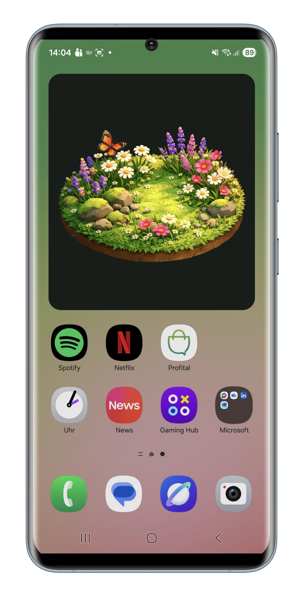
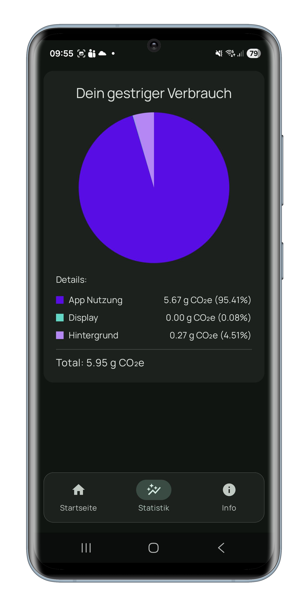
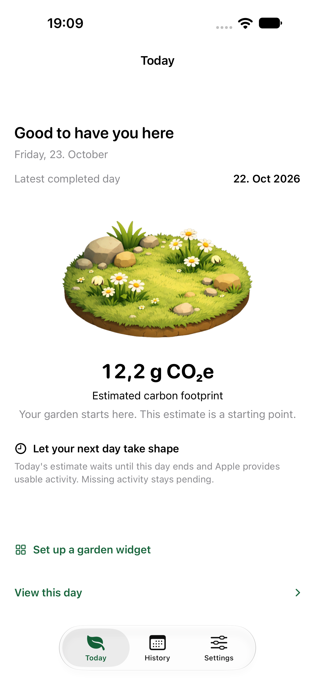
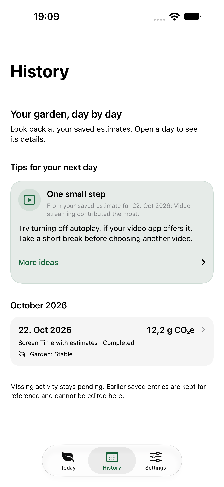

# Digital Footprint Explorer

Digital Footprint Explorer (DFE) is a research app from the Zurich University of Applied Sciences (ZHAW). It estimates the greenhouse gas emissions linked to everyday phone use and shows changes over time through a digital garden. Android and iPhone use the same Kotlin calculation model, with separate interfaces and activity sources.

| Android | iPhone |
| --- | --- |
| Available on [Google Play](https://play.google.com/store/apps/details?id=ch.zhaw.digitalfootprintexplorer). Includes a garden, daily statistics and a Home Screen widget. | In testing. Includes Today, History, small and medium Home Screen widgets, optional morning reminders and an optional Apple Watch companion. |
| [Android setup and tests](apps/android/README.md) | [iOS and watchOS setup and tests](apps/ios/README.md) |

## App previews

<table>
  <tr>
    <th>Android garden widget</th>
    <th>Android statistics</th>
    <th>iPhone Today</th>
    <th>iPhone History</th>
  </tr>
  <tr>
    <td><a href="docs/images/widget.png"></a></td>
    <td><a href="docs/images/stats.png"></a></td>
    <td><a href="apps/ios/docs/images/ios-today.png"></a></td>
    <td><a href="apps/ios/docs/images/ios-history.png"></a></td>
  </tr>
</table>

## How it works

Android uses Usage Access and the device statistics it can read. On iPhone, a completed day can be imported after the user allows Screen Time access and Apple supplies usable app activity. Data traffic on iPhone is estimated using category averages. The model also uses assumptions for other inputs, such as brightness and Bluetooth use on iPhone. Both apps show estimated CO₂e.

The iPhone app calculates and saves results on the device. After the user turns on Apple Watch sharing, the paired Watch can show the latest saved iPhone summary. Apple controls when background work and widget updates run. Expanded Screen Time access for Swiss App Store customers is still awaiting confirmation. See the [iOS support page](docs/support-ios.html) and [privacy policy](docs/privacy-policy.html).

## Repository layout

```text
.
├── apps/
│   ├── android/                     # Android app, widget and JVM unit tests
│   │   ├── build.gradle.kts          # Android module configuration
│   │   ├── src/androidMain/         # Compose screens, activity sources and resources
│   │   ├── src/androidUnitTest/     # Tests for installed apps, usage and network data
│   │   └── README.md                # Android setup and test commands
│   └── ios/                         # iPhone and Apple Watch Xcode project
│       ├── iosApp.xcodeproj/        # Targets and shared schemes
│       ├── Configuration/           # Build settings, entitlements and privacy source
│       ├── iosApp/                  # SwiftUI screens, import, history and reminders
│       ├── GardenWidget/            # iPhone Home Screen widget extension
│       ├── WidgetShared/            # Shared iPhone app and widget code
│       ├── WatchApp/                # Apple Watch companion
│       ├── WatchWidgets/            # Watch complications and Smart Stack
│       ├── CompanionShared/         # Data shared with the paired Watch
│       ├── iosAppTests/             # iOS unit and integration tests
│       ├── iosAppUITests/           # iPhone layout and navigation tests
│       ├── WatchAppUITests/         # watchOS UI and system-host checks
│       ├── scripts/                 # Simulator, privacy and release checks
│       ├── tests/                   # Python tests for the local tools
│       ├── docs/                    # Device acceptance notes and screenshots
│       └── README.md                # iOS and watchOS setup, tests and signing
├── shared/
│   ├── build.gradle.kts              # Shared Kotlin and SQLDelight configuration
│   └── src/
│       ├── commonMain/              # Emissions model, iOS bridge and SQLDelight schema
│       ├── commonTest/              # Model and bridge tests
│       ├── androidMain/             # Android database driver
│       └── iosMain/                 # Native database driver
├── docs/                            # Project website served by GitHub Pages
│   ├── architecture/diagrams/       # PlantUML architecture diagrams
│   ├── dfe-sensitivity-analyser/    # Web tool for exploring model assumptions
│   ├── images/                      # Site images and Android previews
│   ├── index.html                   # Project page
│   ├── support-ios.html             # Public iPhone help
│   ├── privacy-policy.html          # Published iOS privacy policy
│   ├── privacy-policy.md            # Text version of the iOS policy
│   └── privacy-policy-content.json  # Structured copy of the iOS policy
├── report/backups/                  # Earlier project report backups
├── .github/workflows/               # Android, iOS and shared CI checks
├── .gitignore                       # Local configuration and build output
├── gradle/                          # Gradle build tools
│   ├── libs.versions.toml           # Plugin, dependency and Android SDK versions
│   └── wrapper/                     # Gradle wrapper files
├── build.gradle.kts                 # Root Gradle build
├── settings.gradle.kts              # Module names and locations
├── gradle.properties                # Gradle build settings
├── gradlew                          # macOS and Linux launcher
├── gradlew.bat                      # Windows launcher
├── LICENSE                          # GNU AGPL v3 licence
└── README.md                        # Project overview and entry points
```

The [architecture diagrams](docs/architecture/diagrams/) describe the shared model and the original Android application. See the platform guides for the current app entry points.

## Build and test

Run commands from the repository root.

### Android

Open the repository root in Android Studio. Use JDK 17 and install Android SDK Platform 36. The app supports Android 7.0 (API 24) and later.

```sh
./gradlew :digitalFootprintExplorer-android:assembleDebug
./gradlew :digitalFootprintExplorer-android:testDebugUnitTest
```

On Windows, run `gradlew.bat` with the same tasks. To install on a connected device or emulator, see the [Android guide](apps/android/README.md).

### iPhone and Apple Watch

Use an Apple silicon Mac with Xcode 27.1 or later, the iOS 27 SDK, JDK 17 and the relevant simulator runtimes. Open the project and select the `iosApp-ScreenTime` scheme for iPhone or `WatchApp` for the companion.

```sh
open apps/ios/iosApp.xcodeproj
bash apps/ios/scripts/ios-check.sh
```

The check runs the shared Kotlin tests and controlled iOS unit tests. The [iOS guide](apps/ios/README.md) covers device signing, interface tests, and the checks that need physical hardware.

GitHub Actions builds the Android debug app and runs its JVM unit tests. A separate job runs the shared Kotlin, iOS and tooling checks. Open the pull request's Checks tab for the results of a specific revision. [CI workflow](.github/workflows/ios-checks.yml)

## Contributing

Open a pull request that explains what changed and how you tested it. Mention which platforms you checked and which still need device testing. Keep signing settings, generated build output and test results outside Git.

DFE is licensed under the [GNU Affero General Public License](LICENSE). For project, support or privacy questions, [email the DFE Team](mailto:digital-footprint-explorer.init@zhaw.ch).
