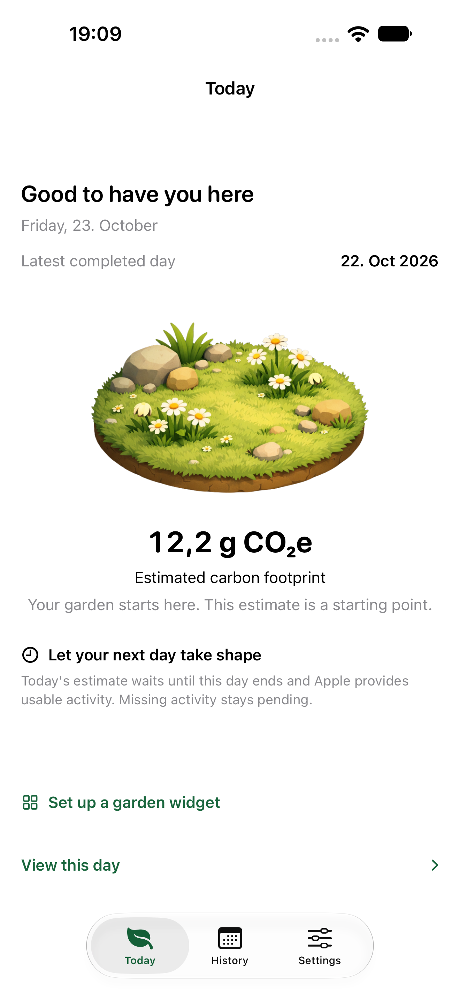
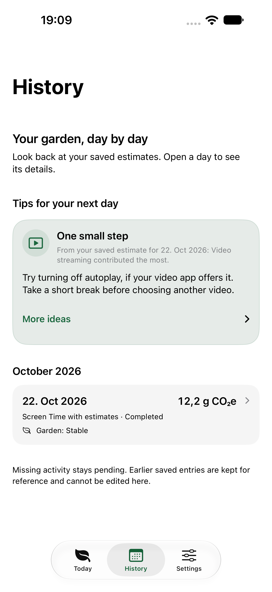
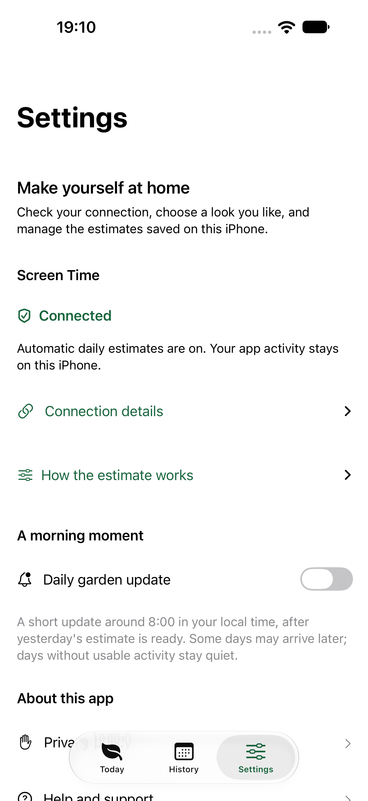

# Digital Footprint Explorer for iOS

The native iPhone app uses the [shared Kotlin emissions model](../../shared/). It turns the available Screen Time activity into a daily estimate, a garden and a local history. The small and medium Home Screen widgets show the latest saved garden.

| Today | History | Settings |
| --- | --- | --- |
|  |  |  |

The previews use sample history. For the Android app and the full source tree, see the [main README](../../README.md).

## Build and run

Use an Apple silicon Mac with Xcode 27.1 or later, the iOS 27 SDK, JDK 17 and a compatible iPhone simulator. Install the matching watchOS simulator runtime to build the embedded companion. The command-line checks also use Python 3.

Open the project from the repository root.

```sh
open apps/ios/iosApp.xcodeproj
```

| Xcode scheme | Minimum OS | What to run |
| --- | --- | --- |
| `iosApp-ScreenTime` | iOS 26.4 | The iPhone app and widgets with automatic Screen Time estimates |
| `iosApp` | iOS 17 | The standard build for development without expanded Screen Time access |
| `WatchApp` | watchOS 10 | The optional Apple Watch companion |

Select a scheme and its simulator in Xcode, then choose **Run**. The iPhone build uses the Gradle wrapper at the repository root to build the Kotlin framework from `shared/`.

### Run on a physical device

1. Copy `apps/ios/Configuration/Local.xcconfig.example` to `apps/ios/Configuration/Local.xcconfig`. Set your approved Apple team and keep this file out of Git.
2. Configure the bundle IDs, App Group and provisioning profiles for the targets you are testing. For automatic imports, the iPhone app and its widget each need their own approved Family Controls and App and Website Usage capabilities. Both need access to the same App Group.
3. On a supported iPhone, tap **Enable automatic estimates** and allow access when Apple asks. DFE then waits for a completed day with usable activity. The user does not need to pick apps or enter daily usage.

For the Watch, use a paired physical iPhone and Apple Watch to check signing and delivery. The iOS unit tests check the data sent by the phone, and the [Watch test guide](WatchAppUITests/README.md) covers the companion and its complications.

## Apple device coverage

The iPhone app adapts to compact screens and the wider iPhone Duo display. The optional Apple Watch companion shows the latest saved garden.

Today keeps one column on compact screens and at larger accessibility text sizes. A regular window at least 760 points wide places the garden beside its actions. On a wide window with moderate height, the result and the link to that day move beside the garden and use larger text. Native tabs can adapt to a sidebar. The same saved dates, pending messages, refresh path and daily calculations apply in each arrangement.

DFE reads Screen Time for the current iPhone. Watch sharing starts off. If the user turns it on, the paired Watch displays the saved iPhone result through Watch Connectivity.

The acceptance record includes simulator results, signed builds and checks that still need physical devices. [Apple device coverage and acceptance](docs/apple-device-coverage.md#acceptance-record)

## Independent widget updates

With automatic setup and the required Apple permissions, the widget can calculate the previous completed day's estimate when WidgetKit runs it. It uses the same Kotlin model as the app. The widget saves a protected pending record before it shows the new garden. When the app opens, it checks each pending day before adding it to private history. Estimates saved under older category rules are kept if the model can reproduce them.

If automatic history is unavailable, the widget pauses new imports and Settings shows that there are pending days to save. Disconnecting stops widget imports. Deleting entries clears old widget work and keeps a valid automatic setup for new days.

iOS chooses when the widget runs. For each release, use a signed build on a physical iPhone to check that the estimate updates on the next day without opening DFE.

## Automatic estimates and privacy

Screen Time supplies the app durations Apple makes available for a completed day. Compare the app time shown in DFE with the daily Screen Time report for the same date and iPhone. The totals can still differ. DFE uses the app activity it receives and leaves any unexplained time out of the estimate.

DFE groups recognised apps by category using their app IDs. The time from other apps stays under **Other apps**. If Screen Time reports screen use but supplies no positive app duration, the day stays pending.

The model estimates traffic from the average rate for each category. Brightness, GPS and Bluetooth also use model inputs. Apple may not report all background music use, and the import excludes website activity. The available data cannot identify call type, video quality or actual traffic.

Automatic setup keeps the saved routine's assumptions, including a valid rate of zero GB/h. It clears usage minutes so Apple can supply them. Existing days keep their saved assumptions. The garden compares each estimate with up to seven earlier saved days.

The app keeps its history on the device. The App Group is the local space shared by the app and its widget. It holds the latest garden summary, automatic setup and a limited set of pending days. Each protected pending record stores category totals and the inputs for the estimate. The app checks the result before saving it to history. App names, app IDs and individual app records stay out of the pending files.

If the user turns on Watch sharing, Apple delivers the latest saved summary to the paired Watch. DFE uses local storage and local notifications. It runs without a DFE account or a project server.

Optional morning reminders are scheduled locally for the next 30 mornings, around 08:00 local time. iOS can show a scheduled reminder even if the user swipes DFE away. Opening the app or running it in the background renews the schedule. The general message varies with the delivery date. If a valid estimate arrives before a reminder is due, DFE can update that same request. If the estimate arrives later, DFE skips a second message for that day.

Turning reminders off cancels pending messages. Deleting entries resets the reminder setting and log. Screen Time access has its own setting.

A reminder and an estimate update run separately. After force-quit, the widget can request activity if iOS runs it. The main app normally needs to be opened again before it can run in the background. iOS also controls delivery, so Focus and notification settings may delay or hide reminders.

Apple's published conditions for expanded access require a device in the EU and an Apple Account set to an EU country or region. Customer access in Switzerland still needs confirmation. [Apple's entitlement guide](https://developer.apple.com/documentation/familycontrols/requesting-the-family-controls-entitlement) · [Expanded access conditions](https://developer.apple.com/documentation/familycontrols/authorizationstatus/approvedwithdataaccess)

## Verify an automatic update

In Settings, open **Connection details** and then **Automatic update checks**. After saving a completed day, the app records the time, how the import started and whether the app was open. The first recorded time is kept when the app opens again. DFE keeps up to 32 completed-day checks with dates and status details.

The iPhone app checks that it can read the shared garden after writing it. The small and medium widgets record their timeline reads separately. Check the actual Home Screen to confirm that the updated garden is visible. **Copy update checks** copies the dates and status details without usage amounts, estimates or app identities. **Delete all entries** also clears these checks.

Use a physical iPhone to verify each beta build. Record the build, completed day, import state and timestamps. Keep system-scheduled updates separate from refreshes started by opening the app or running a debugger.

## Run the checks

Run these commands from the repository root.

```sh
python3 -m unittest discover -s apps/ios/tests -v
python3 apps/ios/scripts/generate_privacy_policy.py --check
python3 apps/ios/scripts/generate_privacy_policy.py --check --include-web
bash apps/ios/scripts/ios-check.sh
```

The last command runs the shared calculation tests, including the iOS bridge and time-unit fixtures, followed by the controlled native unit tests. Set `DFE_SIMULATOR_ID` to choose a particular installed simulator. It writes an `.xcresult` bundle outside the repository by default and prints its path. These tests use isolated stores and do not request personal Screen Time access.

GitHub Actions runs these checks for pull requests to `main` and saves the logs, shared reports and `.xcresult` for 14 days. The runner selects an installed Xcode, a compatible standard iPhone simulator and a matching watchOS runtime. It runs unsigned builds and controlled tests. Live Screen Time checks require a physical phone.

To run the interface tests, replace the destination below with an installed iPhone simulator.

```sh
xcodebuild -project apps/ios/iosApp.xcodeproj \
  -scheme iosApp-ScreenTime -configuration ScreenTimeDebug \
  -destination 'platform=iOS Simulator,name=iPhone 18 Pro Max' \
  -parallel-testing-enabled NO CODE_SIGNING_ALLOWED=NO \
  -only-testing:iosAppUITests test
```

Use a physical device to check live Screen Time import, a new-day background update, the visible widget and reminder delivery before release.

## Local tools

Edit `apps/ios/Configuration/PrivacyPolicyContent.json` and run `python3 apps/ios/scripts/generate_privacy_policy.py` from the repository root. This updates the Swift copy in the app. Add `--include-web` to also update `docs/privacy-policy.html`, `docs/privacy-policy.md` and `docs/privacy-policy-content.json`. Add `--check` to report differences without writing files. GitHub Pages serves the public copies from `main`.

`apps/ios/scripts/check-ios-release.py` inspects a built bundle or archive without uploading it or changing signing resources. Pass `--require-store` when a distribution signature, approved public URLs and matching Store profiles are required. Its `--project-root` input is the repository root.

The export options and Store checker target the ZHAW release identity. For development, select your approved team in the ignored `apps/ios/Configuration/Local.xcconfig` file.

Before archiving for distribution, choose an unused build number. Set `DFE_SOURCE_REVISION` to the reviewed Git revision or a recorded source fingerprint. Check that the iPhone app, Home Screen widget, Watch app and Watch widget all contain the same value.

## Source map

```text
apps/ios/
├── Configuration/        # Capabilities, policy source and local signing example
├── iosApp.xcodeproj/     # Xcode project and shared schemes
├── iosApp/               # SwiftUI app, local storage and automatic refresh
├── GardenWidget/         # Small and medium WidgetKit layouts
├── WidgetShared/         # Shared calculation inputs, pending imports and widget storage
├── WatchApp/             # Optional display of a saved paired-iPhone result
├── WatchAppUITests/      # Isolated Watch views and a separate system-host audit
├── WatchWidgets/         # Watch complications and Smart Stack layout
├── CompanionShared/      # Bounded Watch payload and local storage
├── iosAppTests/          # Controlled model, storage and refresh tests
├── iosAppUITests/        # Navigation, layout and accessibility tests
├── scripts/              # Local build, policy and release checks
├── tests/                # Python tests for those checks
└── docs/                 # Device acceptance notes and example-history previews
```

## Public pages and contact

The DFE Team maintains the app and answers privacy and support questions at [digital-footprint-explorer.init@zhaw.ch](mailto:digital-footprint-explorer.init@zhaw.ch). The app includes an offline copy of the policy. Before App Review, check that the live pages match the URLs in App Store Connect. [iPhone support](https://zhaw-init-softwareengineering.github.io/digital-footprint-explorer/support-ios.html) · [iOS privacy policy](https://zhaw-init-softwareengineering.github.io/digital-footprint-explorer/privacy-policy.html)
